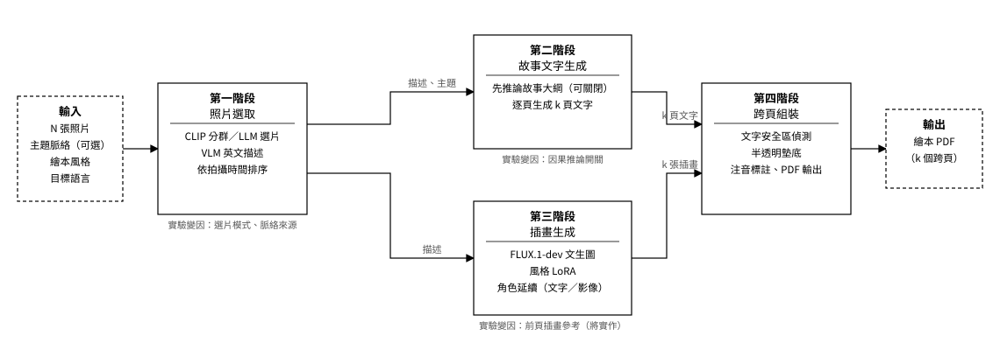

# 第三章 研究方法

> 草稿版本 — 2026-08-11 初稿，2026-10-02 補充決策四，2026-10-15 依實作現況改寫 3.1、3.3（第一階段選片模式、模型後端）。範圍僅涵蓋系統設計（四階段處理流程與關鍵設計決策），評估方法論、量化指標與消融實驗設計留待第四章「實驗設計與結果」討論。技術名詞的原始文獻暫以 `[CITATION NEEDED: 技術名稱]` 標記，待第二章「文獻回顧」整理完成後換成正式引用。決策四（3.7 節）對應之影像條件化機制已確定納入本研究範圍，截至本稿撰寫時尚未實作，排程於第二階段確認完成後進行，詳見 3.7 與 3.8 節註記。

## 3.1 研究問題回顧

本研究的核心系統 Photo2Story，將使用者上傳的一組照片轉換為一本圖文並茂的兒童繪本，圍繞四個研究問題展開：**RQ1** 探討照片選取策略——隨機、純視覺多樣性、純語意的列表式選取、先多樣性後相關性過濾的混合式，以及在視覺分群內以語意挑選的混合式變體——對選片結果與成書品質的影響；**RQ2** 探討主題脈絡（context）的提供方式（完整句子、關鍵字，以及未提供時由系統自行推論）如何影響選片的主題相關性與生成故事的具體性；**RQ3** 探討兩步式因果敘事推論（先推導故事大綱、再逐頁生成文字）相較於單步生成，是否能提升頁與頁之間的敘事連貫性；**RQ4** 探討以前頁插畫作為影像條件的角色延續，相較於純文字層級的延續，是否降低角色外觀的跨頁差異。本章描述支撐這四個研究問題的系統實作，作為第四章消融實驗的基礎。消融實驗（ablation study）指逐一關閉或替換單一元件、量測結果的變化，以得知該元件的貢獻。

## 3.2 系統總覽

Photo2Story 由四個階段依序串接而成，每個階段的輸入與輸出格式皆明確定義：

**圖 3-1　Photo2Story 四階段處理流程。** 實線方塊為系統階段，虛線方塊為輸入與輸出；箭頭上的文字為階段間傳遞的資料，方塊下方的灰字為第四章實驗中可切換的變因。第二階段與第三階段皆以第一階段的輸出為輸入、彼此獨立，於第四階段匯合。

四個階段各自獨立、以明確定義的資料結構銜接，這個切分方式本身即服務於消融實驗：每個階段的行為皆由設定檔中的參數控制（如第一階段的選片模式、第二階段的因果推論開關，以及將實作的第三階段前頁插畫參考開關），可個別開關以量測單一元件的貢獻，而不需更動其他階段的程式碼。此外，每個階段都能以前一階段已存檔的輸出單獨執行：例如第二階段可直接讀取第一階段某次選取的結果來生成故事，而不必重新選片。這讓不同實驗條件得以在完全相同的輸入上比較，也避免了上游的隨機性混入下游的量測。

**模型後端。** 系統中有三類生成模型：讀圖寫描述的視覺語言模型（VLM，第一階段）、處理文字的大型語言模型（LLM，第一階段的評分與選片、第二階段的故事生成）、以及產生插畫的擴散模型（第三階段）。前兩類在本研究中預設為同一個自行架設的開放權重模型 Gemma 4 `[CITATION NEEDED: Gemma]`，透過實驗室內部伺服器提供服務；選擇自行架設模型的考量有三：消融實驗需要上千次呼叫，按次計費的雲端服務成本難以預估；輸入是家庭成員（含兒童）的照片，不應離開內部網路；開放權重模型的版本可固定，實驗可重現。雲端的 Gemini `[CITATION NEEDED: Gemini]` 保留為第二個後端，透過相同的介面呼叫，供第四章在公開資料集上做模型穩健性檢驗。兩個後端僅以「文字進、文字出」與「圖片加文字進、文字出」兩個函式銜接各階段，階段程式碼不依賴特定模型；模型選擇屬於工程決策，不是本研究的貢獻。插畫模型採 fal.ai 雲端服務執行的 FLUX.1-dev，理由見 3.5 節。

## 3.3 第一階段：照片選取（Photo Selection）

第一階段（程式中編號為 Stage 0，四個階段依序對應 Stage 0–3）從使用者上傳的 N 張照片中挑出 k 張作為繪本的頁面來源（k 為設定參數，預設為 4），並為每張照片產出一段英文視覺描述，最後依拍攝時間排序。本階段由四個可獨立替換的元件組成：（一）視覺編碼，以 OpenCLIP `[CITATION NEEDED: CLIP]`（ViT-B/32 架構、OpenAI 權重）將每張照片轉為單位向量，再以 K-Means 分為 k 群（固定亂數種子、10 次初始化取最佳）；（二）視覺描述，以視覺語言模型（VLM）對照片產出「人物、動作、地點、氛圍」的英文描述——描述只取決於照片與模型、與使用者脈絡無關，且將溫度參數設為零，因此系統以模型為單位將描述快取於磁碟，同一張照片在不同實驗條件下不重複呼叫模型；（三）語意判斷，以大型語言模型（LLM）閱讀描述文字來評分或選片；（四）時序排序，讀取 EXIF 拍攝時間（含 iPhone 預設的 HEIC 格式），無時間資訊的照片維持輸入順序。本研究的 VLM 與 LLM 預設皆為自行架設的 Gemma 4 `[CITATION NEEDED: Gemma]`（模型選擇的考量見 3.2 節），但四個元件僅透過文字介面銜接，模型可整體替換。

系統支援五種選片模式，對應 RQ1 的消融變因，差別在於「多樣性」與「主題相關性」各由哪個元件負責、以何種順序結合：

| 模式 | 程式名稱 | 做法 | 角色 |
|---|---|---|---|
| 隨機抽樣 | `random` | 以固定的亂數種子隨機抽 k 張 | 基準 |
| 視覺分群法 | `clip_only` | K-Means 分 k 群，每群取最靠近群中心的一張 | 純視覺多樣性，不讀內容 |
| 語意選取法 | `llm_only` | VLM 描述全部 N 張，LLM 一次讀完所有描述並以編號指定 k 張（列表式選取，listwise selection） | 純語意判斷；無硬性多樣性約束，僅於提示中要求涵蓋不同時刻 |
| 混合過濾法 | `hybrid` | 先以視覺分群法取得 k 張候選，LLM 對每張候選依主題給 0–1 的相關性分數，低於 0.4 者由其餘照片中分數最高者替換（門檻為固定常數，未調校） | 多樣性在前、相關性過濾在後 |
| 群內語意選取法 | `hybrid_v2` | K-Means 分 k 群決定要涵蓋的場景，每群內由 LLM 以列表式選取挑出一張 | 多樣性在前、語意判斷在群內 |

其中語意選取法採列表式選取而非逐張評分，是因為逐張獨立評分沒有比較基準——每張照片都只被問「與主題是否相關」，同分時無從排序；一次給出全部描述、要求直接指定 k 張，才能讓模型在照片之間做相對判斷。模型若指定了無效或重複的編號，缺額則隨機補齊；隨機過程使用固定的亂數種子，使結果可重現。群內語意選取法則是混合過濾法的變體：保留分群以保證場景涵蓋，但不再取群中心——群中心是該群在視覺上「最典型」的照片，典型性與敘事價值是兩個不同的準則——也不再依賴逐張分數，改由 LLM 在群內判斷。

主題脈絡（context）的來源有兩種：使用者以自然語言提供，或在未提供時由系統從照片描述推論一句主題。推論的依據因模式而異：語意選取法與群內語意選取法已描述全部照片，從全部描述推論；視覺分群法與混合過濾法只描述候選，因此從候選的描述推論。後者有一個設計上的必然結果：主題由候選本身歸納而來，候選對該主題的相關性自然偏高，混合過濾法的替換機制在無使用者脈絡時傾向不觸發——換言之，混合過濾法的相關性過濾只有在使用者提供主題時才有實質作用，這一點在第四章以 RQ2 的脈絡條件檢驗。

第一階段的輸出除了 k 張照片的檔案位置（選取順序與時序兩種）、描述與最終生效的主題脈絡之外，另附一組診斷資料：全部照片的群標籤、所有曾被評分照片的相關性分數、混合過濾法的每一次替換紀錄，以及所有曾被描述照片的描述文字。這些資料不影響下游階段，但讓第四章能解釋每一次選取「為什麼選了這幾張」，而不只是比較最終結果。

## 3.4 第二階段：故事文字生成（Story Generation）

第二階段依據第一階段選出的 k 張照片的英文描述（依拍攝時間排序）、最終生效的主題脈絡、繪本風格、目標語言與閱讀層級，產出 k 頁故事文字。主題脈絡沿用第一階段的結果——使用者提供的句子，或系統推論的一句主題——兩個階段看到的是同一段文字；第四章 RQ2 的脈絡條件是在系統入口施加的，不是第二階段另行處理。目標語言以 BCP 47 語言代碼指定（如 zh-TW、ja），閱讀層級則有兩組預設：「簡易」對應學齡前讀者，每頁一句短句（中文約 24 字以內）並限制於幼兒常用詞彙；「標準」對應較年長讀者，每頁二至三句。繪本風格只以風格名稱出現在提示中，供文字語氣參考，實際畫風由第三階段決定。

生成分兩步。第一步是**可開關的因果推論步驟**（對應 RQ3）：LLM 先讀完全部照片描述與主題，用二至三句話寫出一段交代「起因—轉折—結束」的故事大綱（narrative arc），明確要求說明場景之間的因果關係。這段大綱是內部的中間表示，以英文產生，不會出現在繪本中。第二步是逐頁生成：將大綱當作劇情骨架，連同逐張照片描述、目標語言、閱讀層級的句數與字數限制一併交給 LLM，要求回傳長度恰為 k 的字串陣列（JSON 格式），每則對應一頁。關閉因果推論步驟時，第二步的提示中大綱欄位為空，其餘完全相同，因此兩種條件的差異只在於有沒有這段大綱。

兩步式設計的假設是：若直接從照片描述一次生成，模型傾向逐頁描述畫面內容，頁與頁之間缺乏因果或情節上的呼應；先寫出故事大綱相當於引入一段思維鏈 `[CITATION NEEDED: chain-of-thought prompting]`，讓模型先確立整體結構再填入細節。這個假設是否成立，由第四章的 RQ3 實驗回答。此外，逐頁生成的提示中明確列出三種延續前頁的具體技巧——重複出現的角色或物件、承接前頁事件的因果結果、場景的延續——並要求輪流使用而非每頁重複同一種，取代單純要求「頁與頁要連貫」的空泛指示；這三種技巧是從本研究蒐集的市售繪本參考語料（0–2 歲與 3–6 歲兩個年齡段的實體繪本，逐頁拍攝）中歸納的常見手法。提示另要求每句在目標語言中必須是完整、自然的句子，不得為了縮短而省略介詞或助詞，這是針對早期版本中文輸出常出現電報式名詞堆疊所加的限制。

模型回覆以程式解析：優先從回覆中取出字串陣列，若格式不符或長度不等於 k，則改以換行切分並補足空頁，同時記錄警告，讓第四章能統計格式失敗的次數。第二階段的輸出為 k 頁文字、故事大綱（關閉時為空）與實際使用的語言代碼。

## 3.5 第三階段：插畫生成（Illustration Generation）

第三階段為每頁產出一張兒童繪本插畫。生成模型為 FLUX.1-dev `[CITATION NEEDED: FLUX]`，由 fal.ai 的雲端服務執行、以 API 呼叫；每頁輸出一張橫幅跨頁插畫，尺寸 1408 × 992 像素（寬高比約 1.42:1，對應兩張直式 A4 頁面併排的實體跨頁），採 28 步推論，提示引導係數（guidance scale）為 3.5——此係數控制畫面貼近文字提示的程度，越高越貼近字面但構圖越僵硬，本研究未另行調整。本機亦保留以 Stable Diffusion 1.5 執行的備用方案，但本機顯示記憶體不足以執行較大的模型，而 SD 1.5 在人物臉部常出現明顯瑕疵，因此實驗一律採用雲端執行的 FLUX.1-dev。

插畫提示的輸入是該頁照片的英文視覺描述，而非故事文字本身。原因有二：擴散模型的文字編碼器以英文語料訓練，非英文提示的品質明顯下降，而故事文字是中文、日文等目標語言；視覺描述則本身即為英文，且是對畫面的客觀事實描述，比敘事文字更適合指定畫面內容。提示的組成依序為：風格描述（置於最前，因文字編碼器會截斷過長的提示）、場景描述、兩段固定的品質提示（要求人體結構合理、畫面中不出現可讀文字與浮水印），以及下一段所述的角色延續描述。每頁各自獨立呼叫生成模型、各自抽樣；模型偶爾會回傳全黑的影像，系統偵測後以新的亂數種子重試，最多三次。

跨頁角色一致性目前透過**文字層級的延續**達成：系統將 k 張照片的英文描述去除重複後串接、截短至固定長度（60 個英文單字），附加在每一頁的提示末尾，讓每次獨立呼叫都帶有相同的角色與場景線索。畫風則由四種風格決定（吉卜力、皮克斯 3D、經典迪士尼、蠟筆），各以一組公開的社群訓練 LoRA `[CITATION NEEDED: LoRA]` 權重實現：LoRA 是掛在基礎模型之外的一組小型附加權重，生成時載入即可讓模型往特定畫風繪製，而不需重新訓練整個模型；本文稱之為「風格 LoRA」，負責確保單本書內畫風一致。

> **將實作（尚未完成）**：文字層級的延續無法約束每頁獨立抽樣的隨機性，膚色等色彩細節仍會跨頁漂移。系統已定案改採「前頁插畫參考」：生成每一頁時，以前 1–2 個跨頁已生成的插畫作為影像條件（image conditioning），透過 FLUX Kontext `[CITATION NEEDED: FLUX.1 Kontext]` 與風格 LoRA、文字提示一併送入生成模型；此機制為可開關的實驗參數，書中第一個跨頁固定改用純文字生成。理由與代價見 3.7 節決策四，限制見 3.8 節。

## 3.6 第四階段：跨頁組裝（PDF Assembly）

第四階段將第二階段的 k 頁故事文字與第三階段的 k 張跨頁插畫組裝為最終的 PDF：每張插畫滿版鋪滿一個對開跨頁（兩張直式 A4 併排），文字直接疊在插畫上。文字放在哪裡，由一套「干擾度圖」（badness map）決定——它以古典電腦視覺方法計算畫面中每個區域對文字的干擾程度，數值愈低愈適合放字。干擾度由三個不需要 GPU 的指標加權而成：頻譜殘差法（spectral residual）的顯著性 `[CITATION NEEDED: spectral residual saliency]`、Canny 邊緣密度 `[CITATION NEEDED: Canny]`，以及灰階的局部變異量，權重依序為 0.5、0.3、0.2，分析時先把插畫縮小至長邊 200 像素以求快速。本節的權重與各項門檻皆以數張樣本跨頁人工調定，未以第四章的實驗資料調校。

候選區塊的搜尋以積分影像（integral image）進行：系統對三種預設的矩形形狀——窄高、中等、寬扁，寬度分別為頁寬的 28%、45%、65%——以及 14 至 26 點、每 2 點一級的字級，逐一計算每個可能位置的平均干擾度，排除會跨越訂口（兩頁接縫）的位置，並要求區塊能容納該頁全部文字且高度不超過頁高的六成。每個候選以「干擾度（權重 0.6）與字級（權重 0.4）」綜合排序，字級大者優先。候選的平均干擾度在 0.35 以下即可直接放字；若超過，或其中任一格的干擾度高於 0.85——亦即文字底下仍壓著一個局部的熱點，例如招牌、反光處——則在文字下方疊一層透明度 0.55 的半透明暗色遮罩（scrim）以確保可讀性，且需要遮罩的候選在排序時扣分。無文字內容的頁面（wordless page）跳過整個偵測與疊加流程，只鋪滿插畫。

整個處理流程固定使用同一套字型（見 3.7 節決策三）：中文以開放授權的「jf open 粉圓」字型排版，英文以 Open Sans。中文輸出另有注音標註模組，以開源的 pypinyin 詞庫 `[CITATION NEEDED: pypinyin]` 查出每個國字的讀音後轉為注音，並補上該詞庫對常見破音字（如「著」）、輕聲與「和」等讀法的錯誤；聲調符號錨定於注音字元本身而非固定高度，以對齊不同字形的視覺中心。

## 3.7 四項關鍵設計決策

以下四項決策在系統演進過程中都曾有具體的替代方案，取捨理由如下。

**決策一：以偵測式文字安全區取代固定文字框。** 早期版本在插畫外保留固定的頂部或底部色塊放置文字，保證任何畫面下文字都可讀，但這與參考繪本的排版方式（文字直接畫在插畫上、放在視覺最安靜處）不符。系統改為全跨頁滿版插畫，以 3.6 節的干擾度圖動態決定文字位置，換取更貼近真實繪本的視覺呈現，代價是失去了固定文字框「絕對安全」的保證，因此需要 3.6 節的遮罩機制作為最後防線。

**決策二：以古典電腦視覺方法取代語意分割模型。** 干擾度圖刻意只用顯著性、邊緣密度、局部變異量這三個不需要 GPU 的傳統影像處理指標，而非採用 SAM 2、Grounding DINO 等語意前景分割模型 `[CITATION NEEDED: SAM 2; Grounding DINO]`。此舉犧牲了語意層級的精確度（例如無法明確區分「人臉」與「背景雜訊」），換取零 GPU 依賴與低延遲；干擾度圖的資料結構預留了加入前景遮罩通道的空間，日後若需要語意精確度可以疊加，而不必重寫版面流程。

**決策三：整個系統固定單一字型。** RQ1 至 RQ3 的消融實驗以照片選取策略與敘事生成方式為自變數，插畫風格與版面已是控制變數；若字型再隨畫風變化，會在既有控制變數上疊加一層未受控的混淆變數。因此整個系統固定使用同一套字型（3.6 節），不隨頁面畫風調整。

**決策四：以前頁插畫參考取代純文字層級的角色延續**（已定案，實作中）。3.5 節的文字層級延續機制能維持角色輪廓層級的一致性，但無法約束擴散模型抽樣過程本身的隨機性，導致膚色等色彩細節跨頁漂移——問題根源不在描述不夠精確，而在每頁獨立抽樣，因此單靠加強文字描述無法解決，需要以影像作為條件。參考影像的來源有兩種可能：一張獨立生成的角色設定圖，或前 1–2 個跨頁已生成的插畫。本研究採後者，理由有二：其一，前幾頁與當前頁在畫風、光線與角色狀態上最接近，以它們為參考比另一張獨立生成的設定圖更不易引入新的差異；其二，不需要額外的前置生成步驟，流程仍是逐頁推進。代價是誤差會沿頁面累積——第二頁若已漂移，第三頁會以漂移後的樣貌為準——這是第四章 RQ4 要量測的風險之一。

## 3.8 已知限制

本節列出系統設計層面的已知限制；屬於實驗結果的限制留待第五章討論。

**角色一致性。** 目前的角色延續機制（3.5 節）僅能維持角色的髮型、臉型、服裝等輪廓層級的一致性；膚色等色彩層級的細節仍會隨頁面獨立生成而漂移——文字描述無論多精確，都無法約束擴散模型每頁獨立抽樣的隨機性。對應的技術調整（前頁插畫參考）已於 3.7 節決策四說明，截至本稿撰寫時尚未完成；其開／關比較見第四章 RQ4。即使完成，以前幾頁為參考也會讓誤差沿頁面累積，且書中第一頁沒有參考可用。

**資訊只經由文字描述傳遞。** 第一階段之後，照片本身不再進入後續階段；故事與插畫都只依據 VLM 的英文描述生成。描述遺漏的細節（人物的姓名與關係、照片以外的事件背景）無從補回，使用者提供的主題脈絡是唯一的補充管道。這也是插畫中的人物不會「長得像」照片中真人的根本原因：插畫模型從未看過照片。

**時序依賴拍攝時間。** 頁面順序取自 EXIF 拍攝時間；缺少時間資訊的照片（例如經社群平台轉存後被剝除中繼資料的照片）只能維持輸入順序，若輸入順序本身無意義，故事大綱會建立在錯誤的先後關係上。

**沒有內容過濾。** 系統不檢查輸入照片是否適合兒童繪本；不合適的照片會照常被描述、選取並畫成插畫。本研究將輸入限定為個人事件相簿（第一章 1.4 節），內容過濾列為未來工作。

**版面的語意盲點。** 干擾度圖只衡量畫面的低階特徵（3.7 節決策二），無法辨識人臉或主體；文字可能落在視覺上安靜、但語意上重要的區域（例如均勻背景前的人臉側邊），目前只靠遮罩機制保證可讀性，無法保證不遮到主體。
