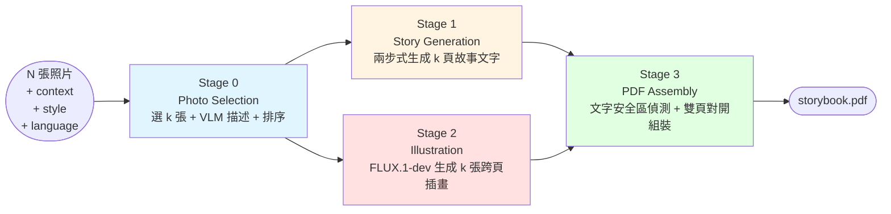

# 第三章 研究方法

> 草稿版本 — 2026-08-11，2026-10-02 補充決策四。範圍僅涵蓋系統設計（四階段 pipeline 架構與四項關鍵設計決策），評估方法論、量化指標與消融實驗設計留待第四章「實驗設計與結果」討論。技術名詞的原始文獻標註以 `[CITATION NEEDED: 技術名稱]` 佔位，待第二章「文獻回顧」整理完成後補齊。決策四（3.7 節）對應之機制截至本稿撰寫時尚在實作階段，詳見段落內註記。

## 3.1 研究問題回顧

本研究的核心系統 Photo2Story，將使用者上傳的一組照片轉換為一本圖文並茂的兒童繪本，圍繞三個研究問題展開：**RQ1** 探討照片選取策略（隨機、純視覺多樣性、純語意相關性、混合式）對成書品質的影響；**RQ2** 探討主題脈絡（context）的利用方式（完整脈絡 vs. 關鍵字脈絡）如何影響生成故事的具體性；**RQ3** 探討兩步式因果敘事推論（先推導敘事弧線、再逐頁生成文字）相較於單步生成，是否能提升頁與頁之間的敘事連貫性。本章描述支撐這三個研究問題的系統實作，作為第四章消融實驗的基礎。

## 3.2 系統總覽

Photo2Story 是一條四階段、輸入輸出契約明確的流水線：

四個階段各自獨立、以明確定義的資料結構銜接，這個切分方式本身即服務於消融實驗：每個階段的行為皆由設定檔（`configs/*.yaml`）中的旗標控制（如 `stage0.mode`、`stage1.use_causal_inference`），可個別開關以量測單一元件的貢獻，而不需更動其他階段的程式碼。

## 3.3 Stage 0：照片選取（Photo Selection）

Stage 0 從 N 張原始照片中挑出 k 張具代表性的照片，並產出每張照片的英文視覺描述。核心技術為 OpenCLIP `[CITATION NEEDED: CLIP]` 視覺編碼搭配 K-Means 分群，確保 k 張候選在語意空間中彼此有足夠差異（避免選出視角雷同的照片）；接著以 Gemini VLM 對每張候選產出「誰、做什麼、在哪裡、氛圍」的英文描述，供下游階段使用。

系統支援四種運作模式對應 RQ1 的消融變因：`random`（隨機取樣，作為基準線）、`clip_only`（純視覺多樣性）、`llm_only`（對全部照片以 LLM 評分後取分數最高的 k 張）、`hybrid`（先以 CLIP 取得多樣化候選，再以 LLM 對候選中與主題相關性低於 0.4 的照片，從候選池中以較高分照片替換）。`hybrid` 模式的動機是：純 CLIP 只保證視覺多樣性，可能選到與主題無關的離群值；純 LLM 評分則可能因缺乏多樣性約束而選出角度相似的照片群。

## 3.4 Stage 1：故事文字生成（Story Generation）

Stage 1 依據 k 張照片的英文描述、使用者提供的主題脈絡、繪本風格與目標語言，產出 k 頁故事文字。生成分兩步：第一步（`use_causal_inference` 旗標控制，對應 RQ3）讓 LLM 先讀完全部照片描述，寫出一段描述「起因－轉折－結束」因果關係的敘事弧線；第二步將此敘事弧線當作劇情骨架，連同逐張照片描述一併餵給 LLM，要求輸出長度恰為 k 的 JSON 字串陣列，每則對應一頁文字。

兩步式設計的動機是：若直接從照片描述一次性生成故事，LLM 傾向逐頁獨立描述畫面內容，頁與頁之間缺乏因果或情節上的呼應；先抽取敘事弧線相當於引入一段思維鏈 `[CITATION NEEDED: chain-of-thought prompting]`，讓模型先確立故事整體結構，再據此填寫細節，藉此提升跨頁敘事連貫性。生成提示（prompt）中另外明確列出三種延續前頁的具體技巧——重複出現的角色或物件、承接前頁事件的因果結果、場景的延續——取代單純要求「頁與頁要連貫」的空泛指示，這三種技巧是從市售繪本參考語料（`reference/0-2/`、`reference/3-6/`）中歸納的常見手法。

## 3.5 Stage 2：插畫生成（Illustration Generation）

Stage 2 為每頁產出風格一致的兒童繪本插畫。生成模型為 fal.ai 託管的 FLUX.1-dev `[CITATION NEEDED: FLUX]`，每頁輸出一張橫幅跨頁插畫（約 1.414:1 寬高比，對應兩張直式 A4 頁面併排的實體跨頁）。插畫提示的輸入是該頁照片的英文 VLM 描述，而非故事文字本身——這是因為擴散模型的文字編碼器在英文語料上訓練，非英文提示品質會明顯下降，而故事文字可能是中文、日文等目標語言，VLM 描述本身即為英文且是對畫面的客觀事實描述，更適合作為生成提示的輸入。

跨頁角色一致性目前透過**文字層級的延續**達成：系統將 k 張照片的英文描述去除重複後串接成一段固定長度的「延續描述」，附加在每一頁的生成提示末尾（"Recurring characters and setting across the book: ..."），讓每次獨立呼叫生成模型時都帶有相同的角色/場景線索。此外，四種預先調校的畫風（ghibli、pixar、disney、crayon）以 LoRA `[CITATION NEEDED: LoRA]` 權重實現，確保單本書內畫風一致。

> **設計中（尚未實作）**：上述文字層級延續機制能維持角色的髮型、臉型、服裝等輪廓一致，但膚色等色彩細節仍會隨每頁獨立抽樣而漂移（見 3.8 節）。系統設計已定案改採**影像層級**的條件化機制：將前 1-2 個跨頁已生成的插畫，透過 FLUX Kontext `[CITATION NEEDED: FLUX.1 Kontext]` 作為額外的影像條件輸入，與既有風格 LoRA 及文字提示一併送入生成模型，取代單純依賴文字描述。此機制由 `stage2.use_character_reference` 旗標控制（與既有 `use_causal_inference` 消融旗標設計模式一致），書中第一個跨頁因無前頁插畫可供參考，固定退回純文字生成路徑。詳見 3.7 節決策四與 `docs/adr/0004-flux-kontext-character-reference.md`。

## 3.6 Stage 3：跨頁組裝（PDF Assembly）

Stage 3 將 Stage 1 的 k 頁故事文字與 Stage 2 的 k 張跨頁插畫組裝為最終 PDF。核心技術是一套以古典電腦視覺方法（saliency 顯著性偵測、Canny 邊緣密度、局部色彩變異量三者加權）計算的「badness map」——描述畫面中每個區域對放置文字而言有多不安全，數值愈低愈適合放字。系統以 integral image 對三種預設矩形形狀（窄高、中等、寬扁）分別搜尋跨頁畫面中 badness 最低、且能容納文字量與字級的候選區塊，並排除跨頁裝訂溝（gutter）區域；找到的候選區塊若仍與畫面熱點重疊，則疊加一層半透明暗化墊底（scrim）以確保可讀性。無文字內容的頁面（wordless page）則跳過整個偵測與疊加流程。中文輸出另外透過 `zhuyin_render.py` 為每個國字加註注音，並將聲調符號錨定於字元本身而非固定高度，以對齊不同字形的視覺中心。

## 3.7 四項關鍵設計決策

以下四項決策皆有明確記錄的取捨理由（見 `docs/adr/`），在系統演進過程中曾有具體的替代方案：

**決策一：以偵測式文字安全區取代固定文字框**（ADR 0001）。早期版本在插畫外保留固定的頂部或底部色塊放置文字，保證任何畫面下文字都可讀，但這與參考繪本的排版方式（文字直接畫在插畫上、放在視覺最安靜處）不符。系統改為全跨頁滿版插畫，以 3.6 節的 badness map 機制動態決定文字位置，換取更貼近真實繪本的視覺呈現，代價是失去了固定文字框「絕對安全」的保證。

**決策二：以古典電腦視覺啟發式取代語意分割模型**（ADR 0002）。badness map 刻意只用 saliency、邊緣密度、局部變異量這三個不需要 GPU 的傳統影像處理指標，而非採用 SAM2、GroundingDINO 等語意前景分割模型。此舉犧牲了語意層級的精確度（例如無法明確區分「人臉」與「背景雜訊」），換取零 GPU 依賴與低延遲，且 `BadnessMap` 的設計預留了未來加入前景遮罩通道的擴充空間。

**決策三：全流水線固定單一字型**（ADR 0003）。RQ1 至 RQ3 的消融實驗以照片選取策略與敘事生成方式為自變數，插畫風格與版面已是控制變數；若字型再隨畫風變化，會在既有控制變數上疊加一層未受控的混淆變數。因此全流水線固定使用同一套字型（jf-openhuninn），不隨頁面畫風調整。

**決策四：以影像條件化（FLUX Kontext）取代純文字層級的角色延續**（ADR 0004，設計已定案、實作中）。3.5 節的文字層級延續機制能維持角色輪廓層級的一致性，但無法約束擴散模型抽樣過程本身的隨機性，導致膚色等色彩細節跨頁漂移——問題根源不在描述不夠精確，而在抽樣本身的隨機性，因此單靠加強文字描述無法解決。系統因此改採前 1-2 個跨頁已生成插畫作為影像條件輸入的方式，取代單純依賴文字描述；採用「前幾頁」的滑動窗口而非固定單一參考插畫（如一張獨立生成的角色設定圖），一方面不需額外的前置生成步驟，另一方面也對應教授建議的「參考前幾頁畫面」做法。

## 3.8 已知限制

目前的角色一致性機制（3.5 節）僅能維持角色的髮型、臉型、服裝等輪廓層級的一致性；膚色等色彩層級的細節仍會隨頁面獨立生成而漂移，這是純文字層級延續機制的已知限制——文字描述無論多精確，都無法完全約束擴散模型抽樣過程本身的隨機性。對應的技術調整（影像條件化機制）已於 3.7 節決策四說明；其消融實驗設計（`stage2.use_character_reference` 開／關比較）見第四章。本章撰寫時該機制尚在實作階段，第四章之消融實驗結果將視實作完成進度補充。
